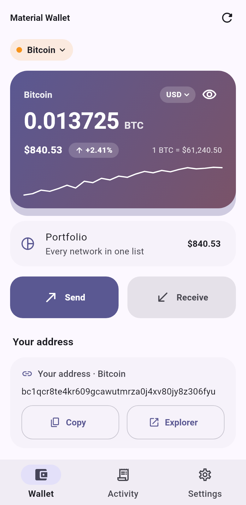
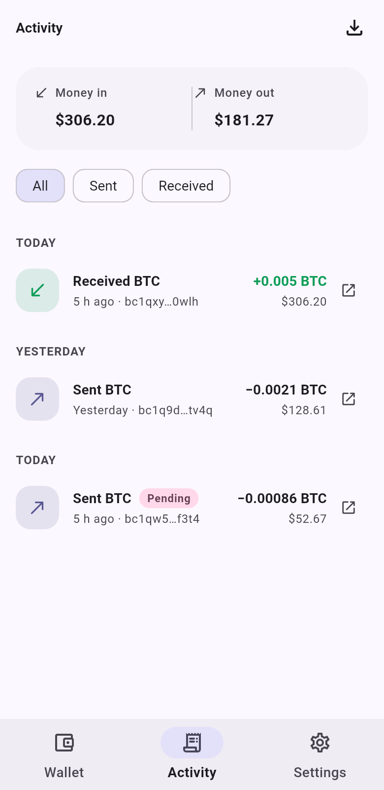
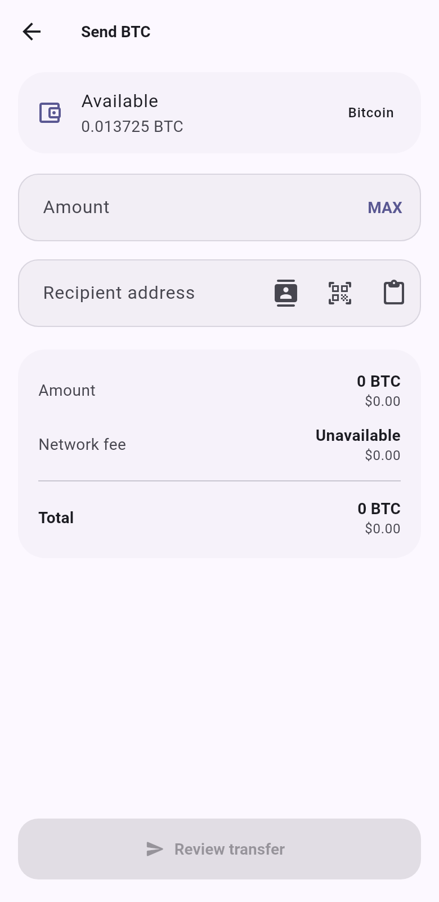
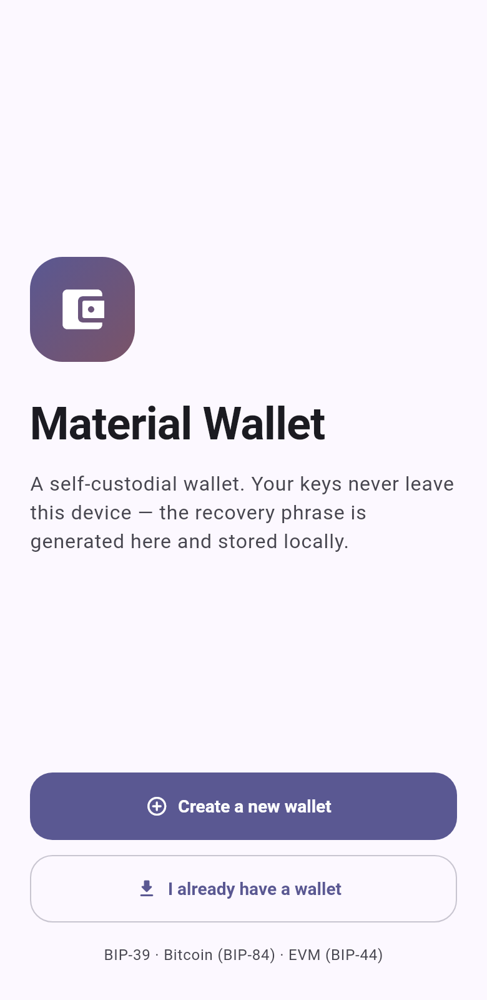
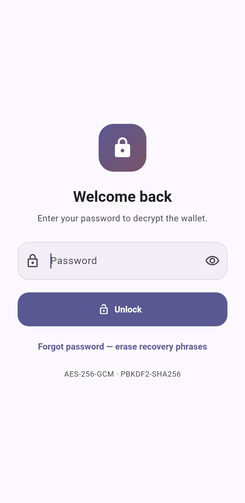
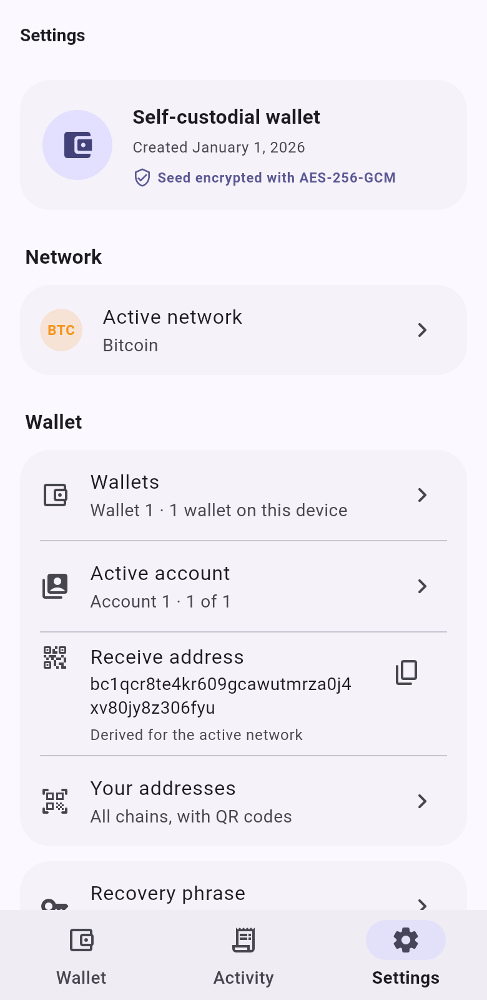

# Material Wallet

A modern, **self-custodial** cryptocurrency wallet built with Flutter and
Material 3. Your keys never leave the device: the BIP-39 recovery phrase is
generated locally, encrypted, and stored only on this device.

> ⚠️ **Disclaimer**
> This project is a **portfolio / educational app**. It derives real public
> addresses, reads live on-chain data, and **signs and broadcasts real
> transactions** on-device: EVM chains (native coin and ERC-20), Bitcoin, and the
> native coin of Solana and Aptos. Every signing path is pinned by reference
> vectors, and the EVM, BNB Chain, Solana and Aptos paths have been checked
> against live nodes **by simulation only — no funded transfer has been sent**;
> the Bitcoin replace-by-fee path has not been tried on a live network at all —
> see [Verifying the signing paths](#verifying-the-signing-paths).
> **Do not use it to store meaningful funds.**

---

## Features

- 🔑 **Create wallet** — generates a BIP-39 recovery phrase (12 or 24 words) with
  an on-screen verification step.
- 📥 **Import wallet** — restore from an existing BIP-39 phrase, with optional
  support for a **passphrase (25th word)**: the phrase and the passphrase are
  both encrypted into the vault and both are needed to restore.
- 👥 **Multiple accounts** — BIP-44 account indexes from the same seed, each with
  its own address on every chain, switchable from Settings.
- 🗂️ **Several recovery phrases** — create or import more wallets next to the
  first. They live in the same encrypted vault under the same password, so one
  unlock opens them all and switching is instant. Adding or removing a phrase
  asks for the password; each wallet keeps its own accounts and names.
- 👁️ **Watch-only wallets** — follow a cold wallet or any public address (Bitcoin,
  EVM, Solana, Aptos — recognised from the pasted address) without holding a key.
  Balances, tokens, history and the portfolio work as usual; sending, speed-up
  and revoking are refused. A device with only watch-only wallets needs no
  password at all, because nothing secret is stored. A followed wallet can be
  edited later, and an ENS name (`name.eth`) can be pasted instead of an address.
- 🌍 **Languages** — English and Ukrainian (Settings → Language; follows the
  system by default). Interface text lives in ARB files under `lib/l10n`.
- 🔒 **Security first**
  - Recovery phrase encrypted with **AES-256-GCM**, key derived via
    **PBKDF2-HMAC-SHA256** (600,000 rounds, OWASP 2023 guidance).
  - Password lock (min. 8 characters; older 6–8 digit PINs keep working), changeable in Settings.
  - **Fingerprint unlock bound to the hardware** (Android): the password is
    encrypted with an AES-GCM key in the Keystore that needs a fresh strong
    biometric for every use, so only a real fingerprint releases it — not a
    flag the app could skip. Enrolling another finger invalidates the key.
  - **Auto-lock** after a configurable time in the background, and
    **attempt throttling** with escalating backoff after wrong PINs.
  - Sending, replacing a transaction and revoking an approval all require
    re-authentication: a **fingerprint when biometric unlock is enabled**,
    otherwise the PIN.
  - The live balance — and a token holding, read on-chain — is re-checked right
    before signing, so a transfer is never signed against a stale number.
  - Revealing the recovery phrase requires re-authentication, and a copied
    phrase is wiped from the clipboard automatically.
  - Screenshots and the app-switcher preview are blocked (`FLAG_SECURE`).
- 🌐 **Multi-chain** — Bitcoin, EVM networks, Solana and Aptos (see table below).
- 💸 **Send** — validates the recipient address per chain (bech32, Base58Check,
  EIP-55, Aptos hex) against the live balance, with **native and ERC-20**
  transfers and Low/Normal/High/**custom** fee presets. On **EVM networks** the
  transfer is signed on-device as an **EIP-1559** (type-2) transaction with a
  fee cap (EIP-2, RFC-6979), re-checks the live balance right before signing,
  and is broadcast for real after a password (or fingerprint) confirmation, ending on a full-screen
  success screen. On **Bitcoin** the transfer is a native SegWit
  (**BIP-143 P2WPKH**) transaction: utxos are selected for the entered amount,
  change returns to your address, the fee is priced in sat/vB with the same
  presets, and the signed transaction is broadcast through mempool.space.
  **Solana** (legacy-format System transfer, ed25519) and **Aptos**
  (`aptos_account::transfer`, BCS, dry-run through `/transactions/simulate`
  first) send their native coin; both re-read balance and chain state at
  signing time, and Solana enforces the rent-exempt rules (a new recipient must
  receive at least ≈ 0.00089 SOL; the sender may not be left below it).
  **BNB Chain** sends too — without a history index, so the send screen says
  there is no speed-up, no confirmation notification and no history-based
  poisoning check there.
- 🔁 **Fallback RPC nodes** — every EVM network lists several broadcast nodes;
  the next one is tried only when a node cannot be reached, never because it
  answered with an error. A node saying "already known" counts as sent.
- 💱 **Fiat amount entry** — type the amount in your display currency; the coin
  amount (rounded down) is what is signed and what the review sheet shows.
- 🪪 **ENS names** — `name.eth` in the recipient field resolves through the ENS
  Universal Resolver; the resolved address is shown under the field and on the
  review sheet, and goes through the same recipient check as a typed address.
  Names with characters the wallet cannot normalise exactly are refused.
- 📒 **Address book** — save recipients with local labels; labels show up in the
  send flow and the activity list.
- 🪙 **Token balances** — ERC-20 holdings with USD values on the Blockscout-backed
  EVM networks (tap a token to send it), and **SPL tokens** on Solana (Token and
  Token-2022 programs; tickers and prices from CoinGecko; tap one to send it —
  the recipient's token account is created when missing and its rent is shown)
  and **Aptos fungible assets** (balances from the Aptos Labs indexer, sendable). Long-press a token to hide it from the list (and again, or
  "Show hidden", to bring it back); a hidden token is also left out of the
  portfolio totals, so a priced airdrop does not inflate them.
- 🚀 **Bitcoin replace-by-fee** — transfers are signed with the BIP-125 sequence,
  and a pending one can be sped up: the same payment from the same coins with a
  larger fee taken out of the change (never from the recipient, never adding
  unconfirmed inputs). A transfer that did not signal RBF, or has too little
  change, says why instead of failing.
- ↩️ **Fix a stuck transfer** — replaces a pending outgoing EVM transaction with
  one that reuses its nonce, either as a **speed-up** (same transfer, higher
  fee) or a **cancel** (zero-value self-transfer that can never confirm). The
  replacement is priced from the stuck transaction's own fee cap plus 10 % (the
  node's rule), and a speed-up of an ERC-20 transfer or approval reuses the
  original calldata byte for byte.
- 🔓 **Token approvals** — lists what contracts are allowed to spend your
  tokens and can revoke each one (`approve(spender, 0)`), the only in-wallet way
  to undo a malicious approval.
- 🕵️ **Address poisoning warning** — on every chain, before sending, a recipient
  whose first and last characters copy an address this wallet already deals
  with is flagged: the scam pattern where a worthless token arrives from an
  address built to look like a contract you trust.
- 🛟 **Recipient check before signing** — on Blockscout-backed EVM networks the
  recipient is looked up right before the signature, so a scam-tagged address,
  a token contract (funds sent there are usually lost) or a token sent to its
  own contract are caught while the transfer can still be stopped. If the lookup
  fails, the send sheet says the address could not be verified rather than
  staying silent.
- 🔔 **Confirmation notifications** — a local notification when an outgoing
  transfer confirms, even after a restart; while a transfer is pending the
  wallet re-reads the chain on its own (EVM ~20 s, Bitcoin ~60 s) so the
  notification arrives without a manual refresh.
- 📬 **Notifications while closed** (Android, opt-in) — a WorkManager job checks
  about every 15 minutes (the system's minimum) for incoming funds and for
  transfers that confirmed. It has no seed and no password: it reads public
  chain data for addresses the app stored while it was unlocked (watch-only
  addresses always). The first look at an address only learns its history; a
  token you do not already hold, or hid, never pings the phone; privacy mode
  keeps amounts out of the text.
- 🔗 **Payment links** — `bitcoin:`, `ethereum:` (EIP-681), `solana:` and
  `aptos:` URIs open the app and prefill the send flow.
- 🧮 **Portfolio** — one screen with the account's holdings on every mainnet,
  largest first: one price request for all coins, balances fetched in parallel,
  tokens included. A network that cannot be read shows as unavailable and the
  total says it may be too low; tap a row to switch to that network.
- 📷 **Receive** — real address as text and a scannable QR code. Enter an amount
  to turn the QR into a payment request (BIP-21, EIP-681, Solana Pay or
  `aptos:`) and share it as text.
- 🗂️ **Your addresses** — every chain's receive address in one place, each with
  a QR code and a verify-against-a-second-device warning.
- 🔍 **QR scanner** — scan a recipient address with the camera.
- 📊 **Live balance, activity & prices** — balances/history from public key-less
  APIs, prices from CoinGecko (cached to respect rate limits). The last snapshot
  is cached locally **per account**, so the app opens with data and works
  offline.
- 📜 **Complete activity** — ERC-20 transfers are merged into the history by
  transaction hash (an incoming USDC now shows up, and "Sent ETH −fee" for a
  token send reads "Sent 100 USDC" with the gas kept), approvals are labelled,
  and **Load more** pages back through Blockscout, mempool.space, Solana and
  Aptos. Search by address, contact label, note, ticker or hash.
- 📝 **Notes, names, privacy** — private notes on transactions, names for your
  accounts, and a balance-hiding mode that persists and applies to the home
  screen, tokens and activity.
- 🧾 **CSV export** — share the loaded activity as a CSV file straight from the
  share sheet, with a separate fee ticker column and your notes.
- 🎨 **Material 3 UI with system colours** — on Android 12+ the whole palette
  comes from the system (Material You, derived from the wallpaper) and follows
  it when it changes; elsewhere the built-in indigo palette is used. Light /
  dark / system theme (persisted), multiple display currencies. Gain and loss
  stay green and red whatever the wallpaper.
- 🧪 **Tested** — unit and widget tests covering derivation, crypto, address
  validation, storage and APIs.

---

## Screenshots

| Wallet                          | Activity                          | Send                          |
| ------------------------------- | --------------------------------- | ----------------------------- |
|  |  |  |

| Onboarding                          | Unlock lock screen                | Settings                          |
| ----------------------------------- | --------------------------------- | --------------------------------- |
|  |  |  |

> The screens were rendered headlessly in the widget-test harness
> (`flutter test tool/screenshots_test.dart --update-goldens`) with a
> deterministic test phrase and canned network responses — no real funds.

---

## Supported networks

| Group   | Network        | Address standard      | Data source                     |
| ------- | -------------- | --------------------- | ------------------------------- |
| Bitcoin | Bitcoin        | BIP-84 (`bc1q…`)      | mempool.space                   |
| Bitcoin | Bitcoin Testnet| BIP-84 (`tb1q…`)      | mempool.space                   |
| EVM     | Ethereum       | BIP-44 (`0x…`, EIP-55)| Blockscout                      |
| EVM     | Base           | BIP-44                | Blockscout                      |
| EVM     | Polygon        | BIP-44                | Blockscout                      |
| EVM     | Arbitrum One   | BIP-44                | Blockscout                      |
| EVM     | BNB Chain      | BIP-44                | public JSON-RPC (no history)    |
| EVM     | Sepolia (test) | BIP-44                | Blockscout                      |
| Solana  | Solana         | SLIP-0010 (ed25519)   | Public Solana RPC               |
| Solana  | Devnet (test)  | SLIP-0010 (ed25519)   | Public Solana devnet RPC        |
| Aptos   | Aptos          | SLIP-0010 (ed25519)   | Public Aptos fullnode           |

Sending is supported on every network above (native coin; ERC-20 on the EVM
networks). Broadcast and signing-side calls on EVM go through a list of public
nodes (PublicNode, dRPC, 1RPC, the chains' own endpoints).

> All balance/history endpoints are **free and key-less** public APIs, so the
> app needs no API keys and no backend.

---

## How the wallet stays safe

- The recovery phrase — and the optional BIP-39 passphrase — are **never**
  written to disk in the clear. They are encrypted together with a key derived
  from the user's PIN and only decrypted into memory after a successful unlock.
- The encrypted vault is a small self-describing JSON blob, so the KDF
  parameters can be raised later without breaking existing wallets.
- Because AES-GCM is authenticated, a wrong PIN cannot silently "succeed": the
  tag check fails and decryption is rejected.
- On the web build, the heavy PBKDF2 derivation runs through the browser's
  **Web Crypto API** so the UI does not freeze.
- When fingerprint unlock is enabled, the password is kept encrypted under a
  Keystore key that requires a strong biometric for every single use (a
  `CryptoObject`), and is released only by that fingerprint. Re-authentication
  before a send or before revealing the phrase uses the same path.
- The vault is re-locked after a configurable period in the background, and
  repeated wrong PINs are penalised with an escalating, persisted backoff.
- The seed is overwritten in memory on lock. Non-secret data (settings, the
  address book, the active account index and the last account snapshots) lives
  in `shared_preferences`.

### What the password does and does not protect

The 600,000 PBKDF2 rounds slow down guessing, but they cannot make a short secret
strong: on a single modern GPU a 6-digit PIN falls in about a minute and an
8-digit one in a couple of hours, once the encrypted vault is in an attacker's
hands. That is why new wallets ask for a **password of at least 8 characters**;
a wallet created earlier with a 6–8 digit PIN keeps unlocking, and Settings lets
you change it to a password.

- **On Android** the vault sits in app-private storage with `allowBackup="false"`
  and the biometric-unlock PIN in the platform keystore, so reading it needs
  root or a forensic image — the password is the second layer, not the only one.
- **On the web** the vault lives in browser storage, which anyone with access to
  the browser profile (an extension, a shared machine, malware) can copy. There
  the password is effectively the only layer, so use a long one — or do not use
  the web build for anything beyond trying the app.
- **Fingerprint unlock is bound to the hardware on Android**: the stored
  password cannot be decrypted without a fingerprint, even by code running
  inside the app or by someone reading its storage. It is still the same
  password — anyone who can both hold your finger to the sensor and unlock the
  phone gets in — and adding a fingerprint to the phone resets it. Copies made
  by versions before 0.5.0 (not bound) are deleted on first launch, so
  fingerprint unlock has to be turned on once more. The web build has no
  fingerprint unlock.
- **Do not put the encrypted seed in a cloud backup**; with a short password it
  can be brute-forced offline.

---

## Tech stack

- **Flutter 3.47** / **Dart 3.13**, Material 3 (CI pins Flutter 3.47.7).
- **provider** for state management; **flutter_localizations** with gen-l10n (English, Ukrainian); **dynamic_color** for the system palette
  (pinned to 1.x: 2.x ships its own copy of Material types that does not match
  Flutter's).
- **pointycastle** (AES-GCM, PBKDF2, ECDSA), **bip39**, **bip32**,
  **ed25519_edwards** for key material and derivation. Bitcoin transactions are
  built and signed against the **BIP-143** sighash; EVM transactions use
  **RLP** + **EIP-1559**.
- **flutter_secure_storage** for the encrypted vault; an own Android Keystore +
  `androidx.biometric` channel (`BoundSecret.kt`) for fingerprint unlock.
- **workmanager** for the opt-in background check.
- **qr_flutter** + **mobile_scanner** for QR codes.
- **http** + **intl** for networking and formatting, **share_plus** for the CSV
  export.

---

## Getting started

```bash
# 1. Install dependencies
flutter pub get

# 2. Run on a connected device / emulator
flutter run

# 3. Run the test suite
flutter test

# 4. Static analysis
flutter analyze

# 5. Build (examples)
flutter build apk --release     # Android
flutter build web --release     # Web
```

**Requirements:** Flutter 3.47+ with Dart 3.13+. For Android builds you also need
an Android SDK and a JDK 17 toolchain (`android/local.properties` is generated
by the Flutter tool and is intentionally git-ignored).

### Verifying the signing paths

Every signing path is pinned by an external vector and has a live check that
spends nothing:

| Path | Vector in the tests | Live check |
| ---- | ------------------- | ---------- |
| EVM (EIP-1559) | EIP-155 / RLP vectors | `dart run tool/verify_eip1559.dart [sepolia\|bsc-testnet\|bnb]` |
| Bitcoin (BIP-143) | the published BIP-143 P2WPKH sighash, byte for byte | broadcast a 1 sat/vB transfer on testnet, then speed it up |
| Solana | `test/ed25519_signers_test.dart`: message and signed transaction match `solders` (the Rust solana-sdk) byte for byte | `dart run tool/verify_solana.dart` — `simulateTransaction` with `sigVerify` on Devnet |
| Aptos | the same file: `RawTransaction`, signing message and signed transaction match the official `aptos-sdk` byte for byte | `dart run tool/verify_aptos.dart` — `/transactions/simulate` on testnet |
| SPL tokens | `test/ed25519_signers_test.dart`: four `TransferChecked` / `CreateIdempotent` messages (Token and Token-2022) match `solders` + `spl.token` byte for byte | `dart run tool/verify_spl.dart` — mainnet simulation with signature verification |
| Aptos tokens | the same file: fungible-asset and legacy-coin transfers match `aptos-sdk` | `dart run tool/verify_aptos_token.dart` — `/transactions/simulate` |
| ENS | EIP-137 namehash vectors, ABI layout of the Universal Resolver call | `dart run tool/verify_ens.dart` — resolves a known name on mainnet |
| Key derivation | BIP-39, BIP-84 and EIP-55 reference values; the official SLIP-0010 ed25519 vectors; account 1–2 and testnet values from an independent BIP-32 implementation | — |

> **Status (2026-10-19):** the vectors run in `flutter test` and in CI on every
> push (CI also builds the Android app, so the native code is compiled on every
> change). The live checks were run against public nodes the same day: **Sepolia,
> BSC testnet, Solana Devnet, Aptos testnet and ENS pass**. The Aptos run found
> a real bug — the wallet's gas-limit floor (2,000) was below the node's minimum
> (5,210 on testnet) and every send would have been refused — which is fixed;
> mainnet's minimum was **not** probed, so run `verify_aptos.dart` against it
> before relying on the new floor. **Not yet run:** a Bitcoin testnet speed-up
> (needs a funded testnet wallet), a real dead first RPC node (the fail-over is
> covered by a test with a fake transport), and an actual funded transfer on any
> network. Do that with a few cents before trusting a path.
>
> **Not run on a device** (no phone was available): the fingerprint-bound key
> (`BoundSecret.kt` compiles into debug and release APKs and its Dart half is
> tested against a scripted channel, but the prompt, key invalidation and
> per-use authentication have not been exercised on hardware) and the
> WorkManager job (the check logic is tested with a fake chain; scheduling,
> battery behaviour and notification delivery are not). Try both on a real
> phone with test funds before relying on them.
>
> The checks can also be started from GitHub: **Actions → Live checks → Run
> workflow**.

---

## Project structure

```
.github/workflows/            # CI (analyze + test) and the manual live checks
lib/
├── main.dart                 # Entry point
├── app.dart                  # Root widget, providers, routing gate
├── core/
│   ├── crypto/               # bech32, base58, slip-10, hashing
│   ├── theme/                # Material 3 themes & colors
│   └── utils/                # formatters, units, explorer links
├── data/
│   ├── models/               # chain kinds
│   ├── networks/             # network config, chain & price APIs
│   ├── background/           # background check (targets, checker, WorkManager glue)
│   └── wallet/               # seed vault, wallet list, address deriver, storage,
│                             # fingerprint-bound password store
├── features/                 # onboarding, lock, home, send, receive,
│                             # activity, settings, scan, network pickers, wallets
├── shared/widgets/           # reusable UI widgets
└── state/                    # controllers (settings, identity, wallet, send,
                              # portfolio, notes, contacts, hidden tokens,
                              # background targets)
android/.../BoundSecret.kt    # Keystore key + BiometricPrompt (the native half)
test/                         # unit and widget tests, incl. signing vectors
tool/                         # live checks (verify_*.dart), screenshot and icon scripts
docs/
├── GOALS.md                  # analysis and development goals (English)
└── ЦІЛІ.md                   # the same document in Ukrainian (original)
```

---

## Roadmap

- [x] Sign and broadcast transactions (EVM) — verified end-to-end on Sepolia.
- [x] Sign and broadcast Bitcoin transfers (BIP-143 P2WPKH, BIP-84 keys).
- [x] Sign and broadcast SOL and APT transfers (reference vectors; live checks
      to be run, see above).
- [x] EIP-1559 typed transactions with a fee cap.
- [x] Reject a transfer whose live balance dropped since the last refresh.
- [x] SPL token balances.
- [x] Biometric (not only PIN) re-auth for revealing the recovery phrase.
- [x] Biometric (not only PIN) re-auth before sending, replacing a transaction
      and revoking an approval.
- [x] Revoke ERC-20 approvals.
- [x] Speed up a stuck EVM transaction (replace-by-fee, same nonce).
- [x] Re-check the live token holding before signing a token transfer.
- [x] Address poisoning warning in the send flow.
- [x] BIP-39 passphrase (25th word) support — encrypted alongside the phrase in
      the vault, applied to every derivation (BIP-39 reference vector pinned).
- [x] Known-answer test vectors for the address derivations beyond the ones
      already pinned (official SLIP-0010 vectors; accounts 1–2 and the testnet
      prefix from an independent BIP-32 implementation).
- [x] CI: `flutter analyze` and `flutter test` on every push and pull request.
- [x] Live checks run against public nodes (Sepolia, BSC testnet, Solana Devnet,
      Aptos testnet, ENS); an Aptos gas-floor bug found and fixed.
- [ ] Live checks still open: Bitcoin testnet speed-up, a real dead RPC node, a
      funded transfer on each network, the Aptos floor against mainnet.
- [ ] Device checks still open: the fingerprint-bound key and the background
      job on a real phone (see the status note above).

### Next: honest numbers (milestone A)

- [x] Live fiat rates for USD / EUR / UAH (replace the static demo rates).
- [x] Portfolio total includes ERC-20 holdings.
- [x] Single source of truth for the app version (About screen).
- [x] Scanner and paste read the amount and chain id from payment links.
- [x] EIP-681 token payment links open a token transfer, or refuse clearly.
- [x] Pending transfers are polled, so "Transfer confirmed" fires without a
      manual refresh.
- [x] Token transfers and approvals appear in Activity, with paging.

### Safer sending (milestone B)

- [x] Recipient check before signing: flags scam-tagged addresses, token
      contracts and token-transfer targets (Blockscout).
- [x] Bitcoin fee presets from the node's fastest / half-hour / hour rates.
- [x] Bitcoin RBF (BIP-125) signalling and Speed up (testnet confirmation to be
      run).
- [x] EVM replacements priced from the original transaction (≥ 110 %) and
      applied to token transfers and approvals too.
- [x] Address poisoning check on every chain, not only EVM.
- [x] Password instead of the 6–8 digit PIN (min. 8 characters; the vault format is unchanged, so old PINs still unlock).

### Multi-chain (milestone C)

- [x] Fallback RPC endpoints for EVM broadcasting.
- [x] Single portfolio screen across all networks.
- [x] Solana SPL tokens, then SOL sending (Devnet added for the live check).
- [x] Aptos APT sending (BCS, dry-run by simulation first).
- [x] BNB Chain sending (BSC testnet profile in the live-check tool).
- [x] Sending SPL tokens (Token and Token-2022) and Aptos fungible assets /
      legacy coins — vectors and no-spend live simulations; not yet a funded send.

### Convenience

- [x] Receive screen with a BIP-21 / EIP-681 / Solana Pay / `aptos:` request
      and share.
- [x] Fiat amount in Send, account names, persistent balance hiding.
- [x] Local notes on transactions, included in the CSV export.
- [x] ENS names in the recipient field.
- [x] Search in Activity.
- [x] Hide a token from the home list; hidden tokens leave the totals.
- [x] Ukrainian localisation (ARB files + a runtime table for messages built
      outside widgets).
- [x] Password strength meter; an older vault is re-sealed with the current
      PBKDF2 rounds. (Argon2 is not done: pure Dart would freeze the UI.)
- [x] Watch-only wallets can be edited; ENS names accepted.

### Beyond one seed (milestone F)

- [x] Watch-only wallets (no key, no password needed on their own).
- [x] More than one recovery phrase per device, one vault and one password.
- [x] Fingerprint unlock bound to a Keystore key (own channel instead of
      `local_auth`).
- [x] Notifications while the app is closed (WorkManager, opt-in).

Full analysis, reasons and acceptance criteria: [`docs/GOALS.md`](docs/GOALS.md)
(English) · [`docs/ЦІЛІ.md`](docs/ЦІЛІ.md) (original, Ukrainian).

---

## License

Released under the **MIT License** — see [`LICENSE`](LICENSE).

---

*Built as a learning project — contributions and feedback are welcome.*
